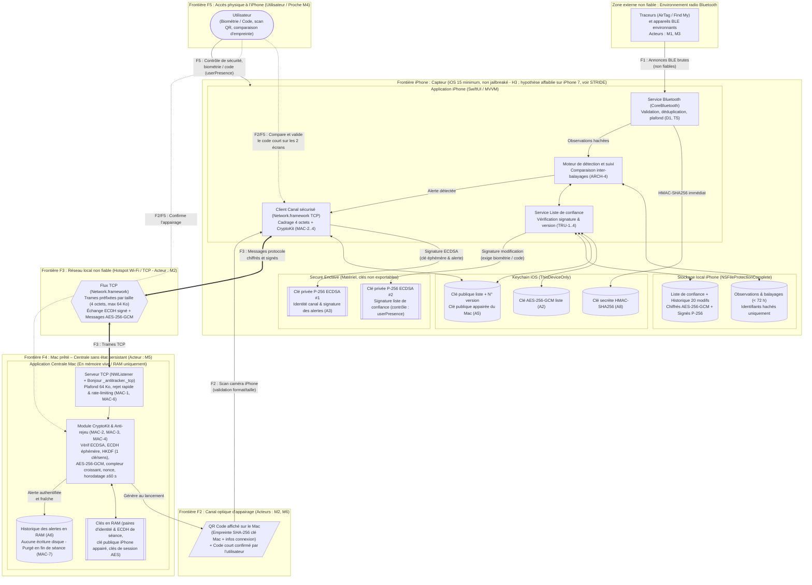

# ARCH-1 – Schéma d'architecture iPhone ↔ Mac et frontières de confiance

> **Mise à jour du 26/11 (PM-11)** : le projet passe à Xcode 16.2 et iOS 15 minimum, et tout se compile sur le MacBook Air de Clara. Les Macs prêtés ne servent plus : « Mac prêté » désigne ici le Mac qui héberge la centrale (désormais celui de Clara), dont les règles « sans état persistant » restent inchangées. Sur iPhone, « Face ID » se lit « biométrie (Face ID ou Touch ID) » et le mode `faceID` devient `biometrie` dans le code (valeur stockée inchangée). Voir `CLAUDE.md` §5 et §6.

> **Statut : proposition rédigée le 24/11/2026, à valider par Aïda et à relire côté attaquant par Clara (RT-1).**
> Responsables : Aïda et Onur. Relecture : Clara (RT-1).
> Références : `docs/securite/STRIDE.md` (SEC-1), `docs/securite/CHOIX_CRYPTO.md` (SEC-3), `docs/architecture/modele-donnees.md` (ARCH-3), `docs/architecture/niveaux-alerte.md` (ARCH-4), `docs/architecture/transport.md` (ARCH-2).
> Règle de vérification (CLAUDE.md, section 5) : tout comportement non encore vérifié sur appareil est marqué **[Hypothèse]**.

## 1. Vue d'ensemble de l'architecture

L'application repose sur une architecture distribuée en deux rôles :
- **Capteur (iPhone)** : effectue les balayages Bluetooth Low Energy à la demande (~30 s), hache immédiatement les identifiants observés (`HMAC-SHA256`), gère la liste de confiance protégée par la Secure Enclave (`userPresence`), évalue le niveau d'alerte (`info`, `alerte`, `critique`) et transmet les événements signés et chiffrés.
- **Centrale (Mac prêté)** : reçoit les événements sur le réseau local (hotspot Wi-Fi via `Network.framework` en TCP), vérifie leur authenticité, leur intégrité et leur fraîcheur (anti-rejeu), et affiche l'historique des alertes de la séance **uniquement en mémoire vive (RAM)**, sans aucune persistance sur disque (`ARCH-7`).

## 2. Schéma global et frontières de confiance (`F1` à `F5`)



## 3. Séquence des flux iPhone ↔ Mac (Frontières `F2` et `F3`)

Ce diagramme détaille l'enchaînement exact des opérations cryptographiques et réseau entre l'iPhone et le Mac prêté lors d'une séance (`MAC-1` à `MAC-4` et `MAC-7`).

```mermaid
sequenceDiagram
    autonumber
    actor U as Utilisateur
    participant SE as Secure Enclave (iPhone)
    participant IPH as App iPhone (Capteur)
    participant NET as Réseau local (F3 : TCP Hotspot)
    participant MAC as App Mac (Centrale - RAM)

    Note over IPH,MAC: Phase 1 : Appairage initial de la séance (MAC-2, Frontière F2)
    MAC->>MAC: Génère paire de clés d'identité P-256 en RAM
    MAC->>U: Affiche QR Code (Empreinte SHA-256 clé publique Mac + infos service TCP)
    U->>IPH: Scanne le QR Code avec la caméra
    IPH->>IPH: Valide format et taille du QR (T4) et extrait l'empreinte SHA-256
    IPH->>NET: Ouvre connexion TCP (NWConnection) vers NWListener du Mac
    NET->>MAC: Nouvelle connexion entrante
    IPH<-->MAC: Échange des clés publiques d'identité P-256
    IPH->>IPH: Vérifie que SHA-256(clé publique Mac) == empreinte du QR Code (S1)
    IPH->>U: Affiche code court / empreinte dérivée des deux clés d'identité
    MAC->>U: Affiche code court / empreinte dérivée des deux clés d'identité
    U->>IPH: Confirme visuellement la correspondance (S4, H4)
    U->>MAC: Confirme visuellement la correspondance (E2)

    Note over IPH,MAC: Phase 2 : Établissement du canal chiffré (MAC-3, Frontière F3)
    IPH->>IPH: Génère paire ECDH P-256 éphémère
    IPH->>SE: Signe la clé publique ECDH éphémère avec la clé d'identité #1
    MAC->>MAC: Génère paire ECDH P-256 éphémère et la signe avec sa clé d'identité RAM
    IPH->>NET: [Taille 4o] Clé ECDH iPhone + Signature ECDSA iPhone
    NET->>MAC: Reçoit et vérifie taille <= 64 Ko, puis vérifie signature ECDSA iPhone
    MAC->>NET: [Taille 4o] Clé ECDH Mac + Signature ECDSA Mac
    NET->>IPH: Reçoit et vérifie taille <= 64 Ko, puis vérifie signature ECDSA Mac
    IPH->>IPH: Calcule secret partagé ECDH + HKDF-SHA256 -> K_i2m et K_m2i (AES-256)
    MAC->>MAC: Calcule secret partagé ECDH + HKDF-SHA256 -> K_i2m et K_m2i (AES-256)

    Note over IPH,MAC: Phase 3 : Envoi d'une alerte signée et chiffrée (MAC-1 & MAC-4, Frontière F3)
    IPH->>IPH: Construit l'événement (Alerte + Compteur croissant + Nonce + Horodatage)
    IPH->>SE: Signe l'événement en P-256 ECDSA (S2, R1)
    IPH->>IPH: Chiffre (Événement + Signature) en AES-256-GCM avec K_i2m (I1, T1)
    IPH->>NET: [Taille 4o] Bloc AES-GCM (nonce + chiffré + tag)
    NET->>MAC: Réception de la trame complète
    MAC->>MAC: 1. Vérifie taille <= 64 Ko et débit (D2, D3, MAC-6)
    MAC->>MAC: 2. Déchiffre et vérifie le tag AES-256-GCM avec K_i2m (T1, I1)
    MAC->>MAC: 3. Vérifie la signature P-256 ECDSA avec la clé appairée de l'iPhone (S2, R1)
    MAC->>MAC: 4. Vérifie compteur > dernierCompteur, nonce inédit et |horodatage| <= 60 s (T2)
    MAC->>MAC: 5. Met à jour dernierCompteur et ajoute l'alerte à l'historique en RAM

    Note over U,MAC: Phase 4 : Fin de séance sur le Mac prêté (MAC-7 & PM-9, Frontière F4)
    U->>MAC: Déclenche la purge de fin de séance (et quitte l'app)
    MAC->>MAC: Efface l'historique en RAM, les clés de session et la clé d'appairage (I4)
```

## 4. Analyse détaillée des frontières de confiance

Chaque frontière correspond à un point d'entrée où un attaquant (`M1` à `M6` définis dans `STRIDE.md`) peut observer, injecter, modifier ou rejouer des données.

### Frontière `F1` : Environnement radio Bluetooth → Application iPhone
- **Flux traversant** : annonces Bluetooth Low Energy brutes (identifiants temporaires, puissance du signal RSSI, charges utiles d'annonce éventuellement de type Find My).
- **Acteurs malveillants** : `M1` (personne qui suit la victime avec un traceur), `M3` (attaquant à portée radio émettant des centaines d'annonces ou des trames malformées).
- **Menaces STRIDE** : `S3` (imitation d'un appareil de confiance), `T5` (annonces malformées), `I5` (collecte d'identifiants de passants – RGPD), `D1` (saturation par flood BLE), `D3` (plantage sur donnée invalide), `D4` (Bluetooth coupé affiché à tort comme « aucun traceur »).
- **Garde-fous à la frontière** :
  1. **Validation sans déballage forcé** : aucun `!`, `try!` ni `fatalError` sur les champs CoreBluetooth (`T5`, `D3`).
  2. **Déduplication et plafond de sécurité** : nombre maximal d'appareils traités par balayage de 30 s (`D1`, `IOS-3`).
  3. **Hachage immédiat** : l'identifiant Bluetooth brut n'est jamais écrit sur disque ni envoyé au Mac ; il est immédiatement transformé en `HMAC-SHA256(clé_keychain, id)` (`I5`, `ARCH-3`).
  4. **Échec explicite en sécurité** : si le Bluetooth est désactivé, la permission refusée ou le balayage interrompu, le résultat est `controleImpossible` et jamais `complet` vide (`D4`, `ARCH-4`).

### Frontière `F2` : Écran du Mac (QR code) → Caméra iPhone et validation humaine
- **Flux traversant** : charge utile du QR code d'appairage (version, empreinte `SHA-256` de la clé publique d'identité du Mac, paramètres de connexion locale) et code court affiché sur les deux écrans.
- **Acteurs malveillants** : `M2` (attaquant réseau tentant un homme du milieu lors de l'appairage), `M6` (QR code malveillant ou substitué).
- **Menaces STRIDE** : `S1` (faux Mac lors de l'appairage), `S4` (substitution de QR code), `T4` (QR code piégé, vide ou surdimensionné), `E2` (pair non autorisé).
- **Garde-fous à la frontière** :
  1. **Validation syntaxique stricte** : contrôle de la taille maximale et du schéma des données décodées du QR code avant toute utilisation réseau ou crypto (`T4`).
  2. **Ancrage cryptographique** : la clé publique présentée par le Mac sur le réseau doit correspondre exactement à l'empreinte `SHA-256` lue dans le QR code (`S1`).
  3. **Confirmation mutuelle par code court** : l'utilisateur vérifie que l'empreinte courte affichée sur l'iPhone et sur le Mac est identique avant d'autoriser le pair (`S4`, `E2`, hypothèse `H4`).

### Frontière `F3` : Application iPhone ↔ Réseau local (Hotspot Wi-Fi / TCP) ↔ Application Mac
- **Flux traversant** : trames TCP (`Network.framework`) préfixées par leur longueur sur 4 octets (`UInt32` big-endian), contenant les messages d'appairage, d'échange de clés ECDH signées et les événements d'alerte chiffrés et signés.
- **Acteur malveillant** : `M2` (attaquant présent sur le même réseau local / hotspot, capable d'écouter, d'injecter, de modifier, de rejouer ou de saturer le port TCP).
- **Menaces STRIDE** : `S1`, `S2` (usurpation du Mac ou de l'iPhone), `T1` (modification d'une alerte en transit), `T2` (rejeu d'un ancien message), `R1` (répudiation de l'origine d'une alerte), `I1` (écoute du trafic), `D2` (flood réseau), `D3` (trame malformée ou taille géante), `D5` (coupure réseau), `E2` (connexion d'un client non appairé).
- **Garde-fous à la frontière** :
  1. **Validation de l'en-tête de 4 octets dès la réception (`ARCH-2`)** : rejet immédiat et fermeture de la connexion si `taille == 0` ou `taille > 64 Ko` (`65_536` octets), avant toute allocation mémoire (`D2`, `D3`).
  2. **Échange de clés authentifié (`MAC-3`)** : ECDH P-256 éphémère signé par les clés d'identité appairées (`S1`), suivi d'une dérivation `HKDF-SHA256` produisant **deux clés distinctes** (une par sens : iPhone → Mac et Mac → iPhone) pour empêcher toute réflexion de message (`I1`).
  3. **Chiffrement authentifié (`MAC-3`)** : `AES-256-GCM` avec nonce généré par CryptoKit à chaque message (`I1`, `T1`).
  4. **Signature matérielle et anti-rejeu (`MAC-4`)** : chaque événement est signé par la clé P-256 ECDSA non exportable de la Secure Enclave de l'iPhone (`S2`, `R1`) et embarque un **compteur strictement croissant par session**, un **nonce** et un **horodatage** vérifié à ±60 s (`T2`).
  5. **Résilience en cas de centrale injoignable (`D5`)** : l'alerte est toujours affichée localement sur l'iPhone ; une perte de connexion TCP ne bloque jamais le contrôle de sécurité.

### Frontière `F4` : Application Centrale Mac (RAM) ↔ Mac prêté (Disque et utilisateur suivant)
- **Flux traversant** : états en mémoire de l'application Mac pendant la séance, logs console éventuels, sessions utilisateur (Apple ID / GitHub) sur la machine prêtée.
- **Acteur malveillant** : `M5` (utilisateur suivant récupérant le Mac prêté après la séance).
- **Menaces STRIDE** : `I2` (fuite d'identifiants ou de positions dans les logs Xcode), `I4` (persistance de l'historique ou des clés d'appairage sur le Mac prêté).
- **Garde-fous à la frontière** :
  1. **Absence totale de persistance sur disque (`ARCH-7`, `MAC-1`)** : ni les clés d'identité/session du Mac, ni les alertes reçues ne sont écrites dans des fichiers ou `UserDefaults` sur le Mac ; tout réside uniquement en mémoire vive (RAM).
  2. **Purge explicite en fin de séance (`MAC-7`)** : action de purge qui vide les structures en mémoire et invalide la session avant la fermeture de l'application (`I4`).
  3. **Silence des logs (`TRU-4`)** : interdiction de tout `print` contenant des clés, des positions, des jetons ou des identifiants Bluetooth (`I2`).
  4. **Hygiène opérationnelle (`PM-9`)** : mise à jour PM-11 : la centrale tourne sur le Mac de Clara, qui n'est plus restitué ; la règle « aucune persistance » reste appliquée (`ARCH-7`, `MAC-7`).

### Frontière `F5` : Utilisateur / Proche ↔ Interface iPhone et Stockage local
- **Flux traversant** : consultation de l'écran, ajout ou suppression d'un appareil dans la liste de confiance, passage de l'application en arrière-plan (aperçu multitâche), accès aux fichiers locaux de l'iPhone.
- **Acteur malveillant** : `M4` (proche ou traqueur ayant brièvement l'iPhone en main, déverrouillé ou non, et éventuellement connaissance du code de déverrouillage).
- **Menaces STRIDE** : `T3` (altération ou restauration d'une ancienne liste de confiance sur disque), `R2` (ajout discret d'un traceur dans la liste de confiance), `I3` (lecture via l'aperçu multitâche ou le presse-papiers), `I6` (lecture des fichiers lorsque l'iPhone est verrouillé), `E1` (contournement de la biométrie pour modifier la liste).
- **Garde-fous à la frontière** :
  1. **Authentification matérielle liée à une clé (`CHOIX_CRYPTO.md` §3.6, `TRU-3`)** : toute modification de la liste de confiance doit être signée par une seconde clé P-256 de la Secure Enclave configurée avec le contrôle d'accès `userPresence` (biométrie Face ID ou Touch ID, ou repli sur le code de l'iPhone), ce qui empêche un contournement par simple modification de condition booléenne (`E1`, `MASTG-TEST-0266`).
  2. **Chiffrement et anti-restauration (`TRU-2`)** : la liste et son historique sont chiffrés ensemble en `AES-256-GCM` (clé en Keychain `ThisDeviceOnly`) et signés avec un **numéro de version croissant** dont la dernière valeur est stockée dans le Keychain (`T3`). En cas d'échec de vérification, l'app échoue en sécurité (aucun appareil n'est considéré de confiance).
  3. **Journal d'audit non supprimable (`R2`)** : les 20 dernières modifications (date, action, nom, mode `biometrie` ou `code` (valeur stockée « faceID » conservée)) sont conservées dans le bloc chiffré/signé, sans bouton de suppression, et toute modification effectuée avec le code est signalée à l'ouverture suivante (atténuation du risque résiduel `RR6`).
  4. **Protection système (`TRU-4`)** : fichiers écrits avec `NSFileProtectionComplete` (`I6`), floutage/masquage de l'écran lors du passage en arrière-plan (`I3`), nettoyage complet du Keychain au premier lancement après réinstallation (`CHOIX_CRYPTO.md` §3.8).

## 5. Récapitulatif de couverture des actifs (`A1` à `A8`)

| Actif (`STRIDE.md`) | Emplacement | Protection architecturale principale |
|---|---|---|
| **A1** – Résultat du Contrôle de sécurité | iPhone | Échec en sécurité si BLE indisponible (`D4`), plafond anti-saturation (`D1`), refus de toute liste de confiance invalide (`T3`). |
| **A2** – Liste de confiance et son historique | iPhone (Fichier + Keychain + Secure Enclave) | Chiffrement `AES-256-GCM` (`I6`), signature Secure Enclave `userPresence` + numéro de version en Keychain (`T3`, `E1`), historique des 20 modifications (`R2`). |
| **A3** – Clés de signature de l'iPhone | iPhone (Secure Enclave) | Clés privées P-256 générées dans la Secure Enclave, matériellement non exportables (`S2`, `R1`, `E1`). |
| **A4** – Clés de session iPhone ↔ Mac | iPhone et Mac (RAM uniquement) | Générées par ECDH P-256 éphémère signé + `HKDF-SHA256` (1 clé par sens), jamais stockées sur disque, détruites en fin de session/séance (`I1`). |
| **A5** – Clés et empreintes d'appairage | iPhone (Keychain) et Mac (RAM uniquement) | Ancrées par le QR code (`SHA-256`) et le code court confirmé par l'utilisateur (`S1`, `S4`, `E2`) ; purgées du Mac en fin de séance (`MAC-7`, `I4`). |
| **A6** – Alertes et historique de la centrale | En transit (`F3`) puis Mac (RAM) | Chiffrement `AES-256-GCM` (`I1`), signature ECDSA Secure Enclave + compteur/nonce/horodatage (`S2`, `T1`, `T2`), stockage en RAM purgé en fin de séance (`I4`). |
| **A7** – Positions ponctuelles (si Niveau 3) | iPhone et Mac | Relevées uniquement au moment d'un balayage, chiffrées au repos et en transit, purgées après 72 h sur iPhone et en fin de séance sur Mac (`I2`, `I5`). |
| **A8** – Identifiants Bluetooth observés | iPhone et Mac | Hachés dès la réception en `HMAC-SHA256` avec clé secrète Keychain `ThisDeviceOnly` ; aucun identifiant brut stocké ou transmis ; purge glissante à 72 h (`I5`). |

## 6. Vérifications et tests associés à l'architecture

- **Revue Red Team (`RT-1`)** : validation par Clara que chaque frontière (`F1` à `F5`) possède des scénarios de test d'intrusion ou de contournement associés dans `RT-2`, `RT-3` et `RT-4`.
- **Vérification des hypothèses architecturales sur matériel réel** :
  - **[Hypothèse H1 / H2]** (`ARCH-6`) : comportement réel des identifiants et annonces d'un AirTag lors du balayage CoreBluetooth sur iPhone.
  - **[Hypothèse Réseau]** (`ARCH-2` / `MAC-1`) : visibilité Bonjour et connexion TCP `Network.framework` entre l'iPhone et le Mac prêté sur le hotspot Wi-Fi d'un téléphone.
  - **[Hypothèse Secure Enclave `userPresence`]** (`CHOIX_CRYPTO.md` §3.6 / `TRU-3`) : déclenchement de l'invite biométrie / code par la Secure Enclave lors de la signature de la liste de confiance et lecture libre de la clé publique pour la vérification.
