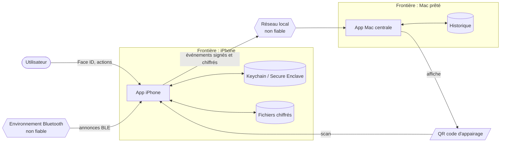

# Modèle de menaces STRIDE – Tracker Bluetooth anti-traçage

> **Statut : brouillon du STRIDE (SEC-1).**
> Les notes de risque et les contre-mesures sont des **propositions**. Les choix crypto définitifs seront justifiés dans CHOIX_CRYPTO
> Règle de vérification (CLAUDE.md, section 5) : tout comportement non testé est marqué **[Hypothèse]**.

## 1. Objet et méthode

Ce document recense les menaces qui pèsent sur l'application, selon la méthode STRIDE :

| Lettre | Catégorie | Propriété violée |
|---|---|---|
| S | Usurpation d'identité (*Spoofing*) | Authentification |
| T | Altération (*Tampering*) | Intégrité |
| R | Répudiation (*Repudiation*) | Non-répudiation |
| I | Divulgation d'information (*Information disclosure*) | Confidentialité |
| D | Déni de service (*Denial of service*) | Disponibilité |
| E | Élévation de privilèges (*Elevation of privilege*) | Autorisation |

Chaque menace a un identifiant (S1, T2, D4…) cité dans les issues, les PR et les commits
(`Menace : D4`). Toute fonctionnalité de sécurité part d'une menace de ce document.

### Notation du risque

Méthode retenue le 23/11 : risque = probabilité × impact, chacun noté sur 3 niveaux.
CVSS pourra servir à noter les failles constatées lors de l'audit croisé (SEC-8).

| | Impact faible (1) | Impact moyen (2) | Impact élevé (3) |
|---|---|---|---|
| **Probabilité élevée (3)** | 3 Moyen | 6 Élevé | 9 Élevé |
| **Probabilité moyenne (2)** | 2 Faible | 4 Moyen | 6 Élevé |
| **Probabilité faible (1)** | 1 Faible | 2 Faible | 3 Moyen |

Règle : toute menace de niveau **Élevé** doit être couverte par une tâche **P1** du backlog.

## 2. Périmètre

- **Utilisateur visé** : un particulier qui craint d'être suivi par un traceur Bluetooth.
- **Fonction principale** : bouton « Contrôle de sécurité », balayage BLE d'environ 30 s,
  alertes à 3 niveaux (info, alerte, critique), comparaison entre balayages.
- **Architecture** : iPhone = capteur ; Mac = centrale (historique, alertes) ; communication
  par le réseau local. La centrale tourne sur un Mac prêté, sans état persistant : appairage
  refait et données recréées à chaque séance (décision du 23/11, ARCH-7).
- **Hors périmètre** (CLAUDE.md, section 10) : GPS continu, scan en arrière-plan, notifications
  push, iCloud, Core NFC, cible autre qu'un particulier.

## 3. Actifs à protéger

| ID | Actif | Où | Propriété principale |
|---|---|---|---|
| A1 | Résultat du « Contrôle de sécurité » (absence de faux négatif) | iPhone | Intégrité, disponibilité |
| A2 | Liste de confiance (appareils de l'utilisateur) | iPhone | Intégrité, confidentialité |
| A3 | Clé de signature de l'iPhone (Secure Enclave, non exportable) | iPhone | Confidentialité |
| A4 | Clés de session iPhone ↔ Mac | iPhone, Mac (en mémoire) | Confidentialité |
| A5 | Clés et empreintes d'appairage | iPhone, Mac | Intégrité |
| A6 | Alertes et historique | Mac | Intégrité, confidentialité |
| A7 | Positions relevées au moment des balayages | iPhone, Mac | Confidentialité (RGPD) |
| A8 | Identifiants Bluetooth observés | iPhone, Mac | Confidentialité (RGPD) |

## 4. Acteurs malveillants envisagés

| ID | Acteur | Capacités supposées |
|---|---|---|
| M1 | Personne qui suit la victime à l'aide d'un traceur | Place un traceur, peut choisir son modèle ; n'a pas accès au téléphone |
| M2 | Attaquant sur le même réseau local | Écoute, injecte, rejoue et modifie le trafic iPhone ↔ Mac |
| M3 | Attaquant à portée Bluetooth | Émet des annonces BLE arbitraires, en grand nombre |
| M4 | Proche ayant brièvement le téléphone en main (déverrouillé ou non) | Accès physique de courte durée |
| M5 | Utilisateur suivant du Mac prêté | Accès au disque et aux sessions laissées ouvertes |
| M6 | Red team (autre groupe) | Toutes les capacités ci-dessus, dans le cadre de l'audit |

## 5. Flux de données et frontières de confiance

À aligner avec le schéma d'ARCH-1.

| ID | Frontière | Pourquoi elle compte |
|---|---|---|
| F1 | Environnement Bluetooth → iPhone | Toute annonce est contrôlée par un tiers potentiel (M1, M3) |
| F2 | QR code → iPhone | Le contenu du QR peut être substitué ou malformé |
| F3 | Réseau local iPhone ↔ Mac | Non fiable (CLAUDE.md, section 6) : M2 peut tout voir et injecter |
| F4 | Mac prêté | Change à chaque séance, aucun contrôle physique durable (M5) |
| F5 | Utilisateur → iPhone | Accès physique d'un proche (M4) |

## 6. Hypothèses de sécurité

| ID | Hypothèse | Statut |
|---|---|---|
| H1 | iOS masque l'adresse matérielle et les identifiants vus par l'app peuvent changer entre deux balayages | **[Hypothèse]** à vérifier avec l'AirTag (ARCH-6) |
| H2 | Les annonces d'un traceur Find My sont reconnaissables par l'app | **[Hypothèse]** à vérifier avec l'AirTag (ARCH-6) |
| H3 | La Secure Enclave et le Keychain de l'iPhone sont fiables (iPhone non jailbreaké) | Hypothèse de confiance assumée |
| H4 | L'utilisateur compare réellement l'empreinte affichée lors de l'appairage | Hypothèse sur l'utilisateur, à faciliter par l'interface |
| H5 | Le Mac prêté n'est pas compromis pendant la séance | Hypothèse de confiance assumée, limitée par la purge (MAC-7) |

## 7. Menaces

Colonnes : **P** probabilité, **Im** impact, **Niv** niveau de risque (proposition).
Statut : `Ouvert`, `En cours`, `Couvert` (contre-mesure implémentée **et testée**), `Accepté` (risque résiduel assumé).

### S – Usurpation d'identité

| ID | Menace | Acteur | Cible | P | Im | Niv | Contre-mesure proposée | Backlog | Test prévu | Statut |
|---|---|---|---|---|---|---|---|---|---|---|
| S1 | Un faux Mac se fait passer pour la centrale lors de l'appairage (homme du milieu) | M2 | A5, A6 | 2 | 3 | Élevé | Appairage par QR code avec vérification d'empreinte de clé des deux côtés ; les clés ECDH éphémères sont signées par les clés d'identité, dont l'empreinte est celle du QR code (sans ce lien, l'échange éphémère est vulnérable) | MAC-2, MAC-3 | Appairage avec une clé différente de celle du QR : doit être refusé | Ouvert |
| S2 | Un appareil du réseau local envoie de fausses alertes au nom de l'iPhone | M2 | A6 | 2 | 3 | Élevé | Événements signés P-256 ECDSA avec clé Secure Enclave ; le Mac n'accepte que la clé appairée | MAC-4 | Message signé par une autre clé : doit être rejeté | Ouvert |
| S3 | Un traceur imite un appareil de la liste de confiance pour ne pas être signalé | M1 | A1, A2 | 2 | 3 | Élevé | **[Hypothèse]** dépend de ce sur quoi repose la reconnaissance d'un appareil de confiance (H1) ; à définir après le spike | ARCH-6, TRU-1 | Spike AirTag puis test de contournement | Ouvert |
| S4 | QR code falsifié ou substitué (photo, autre écran) | M2, M6 | A5 | 1 | 3 | Moyen | Empreinte courte affichée sur les deux appareils et confirmée par l'humain (H4) | MAC-2 | Scan d'un QR d'un autre Mac : l'empreinte doit différer | Ouvert |

### T – Altération

| ID | Menace | Acteur | Cible | P | Im | Niv | Contre-mesure proposée | Backlog | Test prévu | Statut |
|---|---|---|---|---|---|---|---|---|---|---|
| T1 | Modification d'une alerte en transit (ex. « critique » devient « info ») | M2 | A6 | 2 | 3 | Élevé | Canal AES-GCM et signature des événements | MAC-3, MAC-4 | Modifier un octet du message : doit être rejeté | Ouvert |
| T2 | Rejeu d'un ancien message (ex. ancien « aucun traceur ») | M2 | A1, A6 | 2 | 3 | Élevé | Compteur strictement croissant par session (mécanisme principal), nonce, horodatage avec tolérance de 60 s ; un message d'une ancienne session ne se déchiffre plus (clés éphémères) – décision du 23/11 | MAC-4 | Renvoyer un message déjà reçu, compteur inférieur ou égal, horodatage hors tolérance : rejet | Ouvert |
| T3 | Modification de la liste de confiance stockée, ou remise en place d'une ancienne version | M4 | A2 | 1 | 3 | Moyen | Liste chiffrée AES-GCM et signée par une clé Secure Enclave dédiée (`userPresence`) ; clé publique et numéro de version dans le Keychain « ThisDeviceOnly » ; signature sur libellé, version et bloc chiffré ; échec = aucun appareil de confiance (décision du 23/11, `CHOIX_CRYPTO.md` 3.6) | TRU-2 | Fichier modifié, ancienne version signée remise en place, signature par une autre clé : refus | Ouvert |
| T4 | Contenu de QR code malformé ou piégé | M6 | App iPhone | 2 | 2 | Moyen | Validation du format et de la taille avant tout usage | MAC-2 | QR vide, trop long, mauvais format : rejet sans plantage | Ouvert |
| T5 | Annonces BLE malformées (champs vides, tailles extrêmes) | M3 | App iPhone | 2 | 2 | Moyen | Validation des données Bluetooth avant usage | IOS-2, IOS-3 | À tester avec un émetteur BLE si disponible, sinon par tests unitaires du parseur | Ouvert |

### R – Répudiation

| ID | Menace | Acteur | Cible | P | Im | Niv | Contre-mesure proposée | Backlog | Test prévu | Statut |
|---|---|---|---|---|---|---|---|---|---|---|
| R1 | Impossible de prouver quel iPhone a émis une alerte | M2 | A6 | 1 | 2 | Faible | Signature par une clé non exportable (A3) | MAC-4 | Vérification de signature côté Mac | Ouvert |
| R2 | Ajout d'un appareil à la liste de confiance sans trace | M4 | A2 | 2 | 3 | Élevé | Historique local des modifications (date, action, appareil, mode d'authentification Face ID ou code), chiffré et signé avec la liste, non supprimable depuis l'interface, 20 dernières entrées conservées ; toute modification faite avec le code est signalée à la prochaine ouverture (décision du 23/11) ; **[Hypothèse]** détection du mode d'authentification à vérifier | TRU-3, TRU-7 (proposée) | Modifier la liste avec le code : signalement à la prochaine ouverture ; aucune entrée supprimable depuis l'interface | Ouvert |

### I – Divulgation d'information

| ID | Menace | Acteur | Cible | P | Im | Niv | Contre-mesure proposée | Backlog | Test prévu | Statut |
|---|---|---|---|---|---|---|---|---|---|---|
| I1 | Interception du trafic iPhone ↔ Mac | M2 | A6, A7, A8 | 3 | 2 | Élevé | Protocole maison avec CryptoKit (décision du 23/11) : ECDH P-256 éphémère authentifié, HKDF-SHA256 avec sel et `info` fixés et documentés, AES-GCM avec nonces générés par CryptoKit (jamais fixes) ; confidentialité persistante | MAC-3 | Capture réseau : aucun contenu en clair | Ouvert |
| I2 | Positions ou identifiants dans les logs | M5, M6 | A7, A8 | 2 | 2 | Moyen | Aucun `print` de données sensibles ; vérifié en relecture de PR | TRU-4 | Revue de code et lecture de la console pendant un balayage | Ouvert |
| I3 | Fuite par l'aperçu multitâche ou le presse-papiers | M4 | A2, A7 | 2 | 1 | Faible | Aperçu masqué en arrière-plan ; presse-papiers local avec expiration | TRU-4 | Passage en arrière-plan : écran masqué | Ouvert |
| I4 | Historique, clés ou sessions laissés sur le Mac prêté | M5 | A5, A6 | 3 | 2 | Élevé | Centrale sur Mac prêté sans état persistant (décision du 23/11) ; purge de l'historique et des clés en fin de séance ; déconnexion Apple et GitHub | MAC-7, PM-9 | Vérifier après purge qu'aucune donnée ne reste | Ouvert |
| I5 | Conservation excessive des identifiants (RGPD) | M5, M6 | A8 | 2 | 2 | Moyen | HMAC-SHA256 des identifiants avec clé secrète stable en Keychain « ThisDeviceOnly » ; purge glissante 72 h après la collecte (décisions du 23/11) | TRU-6, SEC-10 | Donnée de plus de 72 h : supprimée ; nouvelle clé au premier lancement après installation | Ouvert |
| I6 | Lecture des fichiers de l'app quand l'iPhone est verrouillé | M4 | A2, A7 | 1 | 2 | Faible | Protection des fichiers « Complete » | TRU-4 | Vérifier l'attribut de protection des fichiers | Ouvert |
| I7 | Lecture de la liste de confiance par une personne qui tient l'iPhone déverrouillé | M4 | A2 | 2 | 1 | Faible | Aucune : la lecture sans authentification est nécessaire au balayage ; la liste ne révèle que les noms des appareils de l'utilisateur | TRU-2 | – | Accepté (RR8) |

### D – Déni de service

| ID | Menace | Acteur | Cible | P | Im | Niv | Contre-mesure proposée | Backlog | Test prévu | Statut |
|---|---|---|---|---|---|---|---|---|---|---|
| D1 | Saturation Bluetooth (centaines d'annonces) qui ralentit ou fait planter l'app | M3 | A1 | 2 | 2 | Moyen | Déduplication et plafond de sécurité sur la liste | IOS-3 | Test unitaire avec un grand nombre d'appareils simulés | Ouvert |
| D2 | Flood de messages vers la centrale | M2 | A6 | 2 | 2 | Moyen | Rejet rapide des messages non authentifiés, limitation de débit | MAC-6 | Envoi massif de messages : la centrale reste utilisable | Ouvert |
| D3 | Message ou donnée malformée qui fait planter l'app | M2, M3 | iPhone, Mac | 2 | 2 | Moyen | Interdiction de `!`, `try!` et `fatalError` sur les données externes | Relecture des PR | Entrées malformées (SEC-5) | Ouvert |
| D4 | Bluetooth coupé ou permission refusée, et l'app affiche « aucun traceur » | M1, M4 | A1 | 2 | 3 | Élevé | Échouer en sécurité : afficher « contrôle impossible » au lieu d'un résultat vide | IOS-2 (**à ajouter aux critères d'acceptation**) | Lancer un contrôle avec Bluetooth coupé et permission refusée | Ouvert |
| D5 | Centrale injoignable : l'alerte n'arrive pas sur le Mac | M2 | A6 | 2 | 2 | Moyen | L'alerte reste toujours affichée sur l'iPhone (notification locale), le Mac n'est pas le seul canal | IOS-8 | Couper le réseau pendant une alerte | Ouvert |

### E – Élévation de privilèges

| ID | Menace | Acteur | Cible | P | Im | Niv | Contre-mesure proposée | Backlog | Test prévu | Statut |
|---|---|---|---|---|---|---|---|---|---|---|
| E1 | Contourner Face ID pour modifier la liste de confiance, notamment un proche qui connaît le code de l'iPhone | M4 | A2 | 2 | 3 | Élevé | Face ID avec repli sur le code de l'iPhone, imposé par la Secure Enclave (`userPresence`) et non par une condition dans le code (MASTG-TEST-0266) ; risque résiduel RR6 accepté (décisions du 23/11) | TRU-3 | Annuler l'authentification : modification impossible ; Face ID échoué puis code correct : modification autorisée | Ouvert (RR6) |
| E2 | Un appareil non appairé obtient le statut de pair de confiance auprès du Mac | M2 | A5, A6 | 1 | 3 | Moyen | Appairage uniquement par QR code ; tout autre pair est rejeté | MAC-2, MAC-6 | Connexion d'un client non appairé : rejet | Ouvert |
| E3 | Accès aux comptes ou secrets de l'équipe via le Mac prêté | M5 | Dépôt, comptes | 2 | 3 | Élevé | Déconnexion systématique ; aucun secret, certificat ni profil dans le dépôt | PM-9, PM-1 | Checklist de fin de séance | Ouvert |

## 8. Synthèse des risques élevés

| Menace | Couverte par une tâche P1 ? |
|---|---|
| S1, S2, T1, T2, I1 | Oui (MAC-2, MAC-3, MAC-4) |
| S3 | Partiellement : dépend du spike ARCH-6, contre-mesure à définir |
| R2 | Oui (TRU-3) ; historique des modifications en TRU-7 (proposée, P2) |
| E1 | Oui (TRU-3), risque résiduel RR6 accepté |
| I4, E3 | Oui (MAC-7, PM-9) |
| D4 | **Non : à ajouter aux critères d'acceptation d'IOS-2** |

## 9. Risques résiduels (proposition)

- **RR1** : un traceur qui n'émet pas pendant les 30 s du balayage n'est pas détecté.
  Conséquence du choix « balayage à la demande ».
- **RR2** : si les identifiants changent entre balayages (H1), la comparaison entre balayages
  et la liste de confiance peuvent être moins fiables. À mesurer avec l'AirTag.
- **RR3** : un iPhone jailbreaké ou compromis sort du modèle (H3).
- **RR4** : l'appairage repose sur la vigilance de l'utilisateur lors de la comparaison
  d'empreinte (H4).
- **RR5** : les données présentes sur le Mac pendant la séance sont exposées à un Mac
  compromis (H5).
- **RR6** : avec le repli sur le code de l'iPhone, un proche qui connaît ce code peut
  ajouter son traceur à la liste de confiance (E1). Risque accepté le 23/11, réduit par
  l'historique des modifications (R2) : l'ajout n'est pas empêché, mais il est signalé.
- **RR8** : la liste de confiance est lisible sur un iPhone déverrouillé, sans Face ID (I7).
  Conséquence du choix de ne pas demander d'authentification à chaque balayage.
- **RR7** : le canal iPhone ↔ Mac est un protocole conçu par l'équipe à partir de primitives
  CryptoKit ; il n'a pas l'éprouvé d'un protocole standard comme TLS. Compensé par une
  documentation étape par étape et les tests QA-3.

## 10. Correspondance avec OWASP MASVS (préparation de SEC-7)

| Domaine MASVS | Menaces liées |
|---|---|
| MASVS-STORAGE | T3, I2, I3, I5, I6, I7 |
| MASVS-CRYPTO | T1, T2, I1 |
| MASVS-AUTH | R2, E1 (la red team pourra relever le repli sur le code : justification RR6 et R2) |
| MASVS-NETWORK | S1, S2, I1, D2, E2 |
| MASVS-PLATFORM | S4, T4, I3 |
| MASVS-CODE | T4, T5, D3 |
| MASVS-RESILIENCE | RR3 |
| MASVS-PRIVACY | I5, A7, A8 |

À vérifier avec la version de MASVS utilisée pour l'audit.

## 11. Décisions

### Prises le 23/11 (Aïda)

| Point | Décision | Menaces liées |
|---|---|---|
| Authentification pour modifier la liste de confiance | Face ID avec repli sur le code de l'iPhone | E1, RR6 |
| Hachage des identifiants | HMAC-SHA256, clé secrète stable en Keychain « ThisDeviceOnly », renouvelée seulement à la réinitialisation des données | I5 |
| Durée de purge | 72 h, purge glissante | I5 |
| Anti-rejeu | Compteur par session (principal), nonce, horodatage avec tolérance de 60 s | T2 |
| Canal iPhone ↔ Mac | Protocole maison avec CryptoKit, clés éphémères signées par les clés d'identité | S1, T1, I1, RR7 |
| Emplacement de la centrale | Mac prêté sans état persistant | I4 |
| Méthode de notation | Probabilité × impact sur 3 niveaux | Toutes |
| Traçabilité de la liste de confiance | Historique local chiffré, non supprimable, 20 entrées, signalement des modifications faites avec le code | R2, RR6 |
| Intégrité de la liste de confiance | Solution B : signature par une clé Secure Enclave dédiée, `userPresence`, numéro de version | T3, E1, RR8 |
| Canal | Une clé dérivée par sens | T1, I1 |
| Premier lancement après installation | Suppression de tous les éléments du Keychain, liste vide | T3, I5 |

### En attente

| Point | Menace liée |
|---|---|
| Reconnaissance d'un appareil de confiance malgré la rotation des identifiants | S3 (après ARCH-6) |
| Transport (Network framework recommandé, Multipeer en alternative) ; si Multipeer : ajouter nom annoncé, invitations en masse, pair non appairé | Décision d'Onur (ARCH-2) |
